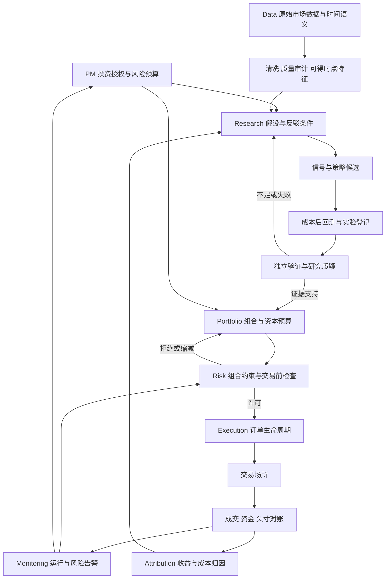

# 系统架构 v0.1

以下是目标架构和接口契约，不是已实现能力清单。
PM 与 Agent 的实际分工、从选题到上线的交付和决策门槛见 [合作协议](OPERATING_MODEL.md)。

2026-10-20 场景审查补充：[OKX Global v0.2 修订建议与完整实施路线](SCENARIO_REVIEW_AND_PLAN.md)。
重点新增产品规则、underlying 风险汇总、日历/公司行动、保证金现金管理及发布/环境隔离；
这些是待讨论的详细设计，不表示生产模块已完成或实盘限额已批准。

资金隔离约束已由 PM 确认，见 [ADR-0003](decisions/0003-usdt-funding-and-strategy-budgets.md)：
仅使用 USDT 资金/保证金、保护预存非 USDT 库存、多策略共享受限总预算并独立记账。
账户层保证金隔离与策略层虚拟分账需分别验证；前者未验收，后者已有本机paper合成实现（ADR-0005），未连接真实账户。

## 机构工作流



基础设施贯穿全流程：权限、调度、持久化、监控、恢复、版本发布。
Operations/Finance 负责资产与资金流核对；实际组织的岗位分工不同，此图是个人项目的参考职责模型。

| 角色 | 交付 | 主要协作/控制 |
|---|---|---|
| Quant Researcher | 经济假设、候选、验证报告、失败记录 | 与 Data 确认数据可得性；与 Execution 校准可交易性 |
| Quant Developer | 可复现研究工具、回测/实盘共享逻辑、测试 | 将研究原型转成确定性模块，避免两套策略实现 |
| Data Engineer | 不可变原始快照、产品主数据、质量与血缘 | 向研究提供 point-in-time 数据，修订不得静默覆盖 |
| PM | 目标、组合、资本预算、晋级/停用决策 | 对总风险负责，不能以研究结果取代资金约束 |
| Risk | 限额、压力测试、拒单、降险与停机政策 | 策略不能绕过；执行前和交易中持续检查 |
| Execution/Trading | 成交质量、订单状态、异常处理 | 反馈实测滑点、拒单和可执行容量 |
| Infrastructure | 调度、权限、日志、备份、可用性 | 进程重启后先恢复和对账，再允许交易 |
| Operations/Accounting | 现金、手续费、funding、持仓、净值对账 | 与场所账单核对，识别损益和资金划转 |

## 软件组织

模块化单体 Python 项目：先本地研究，后独立的常驻交易进程。依赖具体版本在 Phase 1 评估并锁定。
推荐研究数据使用 Parquet + DuckDB；单进程元数据/实验索引先用 SQLite；
需要多进程并发写入和运行服务时再评估 PostgreSQL。均是拟定选择，未安装依赖。

目标代码命名空间：

```text
src/miniquant/
  domain/        # 产品、事件、单位、订单和账本的领域对象
  data/          # 原始采集、质量、可得时点查询、版本清单
  features/      # 因果特征；不直接访问未来数据
  research/      # 研究计划、试验登记、运行编排
  alpha/         # 信号；不能调用交易 API
  backtest/      # 时钟、模拟 broker、成本、事件回放
  validation/    # walk-forward、bootstrap、PBO、DSR 报告
  portfolio/     # 多信号合成、风险预算、目标仓位
  risk/          # 拒绝、缩减、降险及 kill switch
  execution/     # 订单规划、幂等、状态机和对账
  adapters/      # 数据/交易场所适配器
  accounting/    # 成交、资金、估值、损益账本
  monitoring/    # 运行、数据、风险、策略监测
```

上面是规划，不提前创建空实现。notebooks 只能消费库，不是生产逻辑的唯一住所。
Alpha → Portfolio → Risk → Execution 是依赖方向，禁止 Alpha → Exchange。

## 跨模块契约

所有数据/事件带 schema_version 和 lineage_id；时间为 UTC timezone-aware。
报告显示时间可为 Asia/Shanghai，交易 bar 边界不得随本机时区改变。

| 对象 | 必须明确的信息 |
|---|---|
| Instrument | venue、产品类型、base/quote/settlement、合约乘数、最小量/价精度、上市/退市及规则生效时间 |
| MarketEvent | event_time、available_at、ingested_at、source、revision、instrument_id；缺失与最终 bar 标记 |
| FeatureSnapshot | decision_time、输入快照哈希、特征版本、最大 available_at |
| AlphaSignal | as_of、instrument、horizon、score、方向、单位、模型版本；score 不自动解释成收益预测 |
| TargetPortfolio | target_id、权重/名义金额、NAV 与货币、风险预算版本、有效期 |
| RiskDecision | 允许/拒绝/缩减、原因、限额版本、账户快照时间、有效期 |
| OrderIntent | client_order_id、risk_decision_id、产品、方向、量、价格约束、有效期 |
| Fill/LedgerEvent | 不可变 event_id、订单关联、时间、数量、成交价、费用币种、资金流水关联 |
| ExperimentManifest | 研究族/候选 ID、Git SHA+dirty patch 哈希、数据/配置/环境哈希、种子、样本切分、成本版本 |

硬不变量：feature 的 available_at ≤ decision_time；尚未完成的 bar 不作已知收盘价。
历史数据只有 event_time 时，不能虚构“已知可得时间”；记录延迟假设和敏感性。
BTCUSDT 现货与永续不是同一产品。交易所计价美元与稳定币风险不得混同。

## 回测与账本

单一时钟驱动：收到可得数据 → 产生信号 → 目标组合 → 风控 → 下单 → 模拟成交 → 入账。
收盘信号不能在同一个已知收盘价无条件成交；最早成交发生在之后的可执行时点。
向量化回测用于筛选，事件回放用于真实时序、费用、部分成交和账本检查；二者用相同基准案例核对。
非连续 CSCV 切片只用于评估已生成的收益，不在拼接边界虚构开平仓。

账本从第一条可交易回测开始建立：
NAV 变化 = 交易持仓估值变化 + funding/利息 - 费用 + 外部净流入（按统一记账约定）。
基于实际成交价计算的交易 PnL 已含成交偏差；归因可以显示滑点，但不得重复从净 PnL 扣除。
资金流不是收益；保证金不是损失；现货与线性/反向合约使用各自估值和现金流规则。

## 风险层

配置项初始为未定，live 默认禁用；缺失关键限额则 fail closed。
包含单币/单策略/单场所限额、gross/net、杠杆、波动率目标、集中度和相关性、
回撤预算、VaR/ES、流动性、funding、稳定币、交易所和压力场景。
压力场景：跳空、相关性趋同、流动性枯竭、funding 飙升、场所断连、稳定币脱锚。
VaR/ES 不能代替压力测试；波动率目标不能保证实际波动率；止损不能保证最大损失。

kill switch 必须区分停止新增风险、取消挂单、有序减仓和紧急平仓。
API 不可达时不能承诺平仓；状态不可信时先阻止新风险并对账。
恢复前必须核验账户、未结订单、持仓和风险状态；具体恢复权限在 Phase 5 定义。

## 订单和故障

生命周期：created → risk-approved → submitted → acknowledged → partially-filled →
filled/cancelled/rejected；增加 unknown 状态处理网络超时。
提交超时不代表订单不存在：用 client_order_id 查询/对账后决定重试。
持久化意图先于发送，去重后处理回报；不能假设网络提供 exactly-once。
风控许可过期或账户变化时重新检查。纸面、回放和实盘复用意图/账本协议。

## 监测与策略退化

先监测数据新鲜度、缺口、时钟、延迟、进程、拒单、未知订单、净值对账、风险超限。
再监测成本偏差、换手、暴露、信号分布、分市场状态净收益与基准残差。
回撤不自动等于 alpha 失效；先排查数据/执行问题，再核查预先设定的退化假设。
按固定节奏评审，避免每天反复显著性检验后择机停用/重启。

## 验证能力路线

时间泄漏测试；费用/funding/合约单位手算案例；账本守恒与对账；
模拟与实盘协议一致性；超时重复提交、部分成交、断连重启、数据过期等故障注入。
先证明一条完整链路，再扩充资产和策略。不能靠目录结构证明鲁棒性。

## 2026-10-21实现边界

研究账本/回放、统计诊断与纯风控检查已实现，本机paper持久预算/订单日志见ADR-0005。
目标架构其他能力不能从这些子模块推断为完成；完整组合Risk、真实订单恢复和监控尚未验收。
Bar完整性不等于可交易性：无成交填充bar可没有时间缺口，仍须传播volume/场所状态。
长执行延迟还须明确等待意图替换和TTL，目前只作已知历史诊断，不部署。

## 严格现货预检查入口（026）

新集成使用miniquant.risk.pretrade_strict.assess_spot_order：拒绝bool、非有限/无法表示的数字及溢出lot比值，再委托原风控规则。旧pretrade.py和包init被历史实验冻结，保留回放语义，不作为新集成入口。仍只是纯现货检查，无账户/发单连接；精确产品规则、原子预留、抵押品隔离和真实对账尚须验收，不将check通过当submission授权。

## 可观测市场状态与专家配置（研究层029/030，未生产接入）

数据/时间质量 → 因果特征 → 状态估计（方向/强弱、波动/压力、区间稳定性）→ 专家目标 → 配置器 → 独立Risk → 意图/执行/归因。状态是带时点和不确定性的估计，不是价格未来路径的标签；数据不足/未知可配置现金。状态层不能直接下单，Risk具有最终拒绝权。

当前已实现market_regimes的固定路径效率/波动六状态与regime_router的统一现货研究账本。首次三个路由无增量，不能生产启用。高低波动标签未额外削减风险，以分离共同波动缩放与策略选择；未实现概率滤波/HMM或网格动态撤单切换。后续若用latent模型，决策只能使用filtered概率，完整样本smoothed状态仅可事后描述。必须与固定混合和连续配权比较，计状态转换时的资金/库存/交易成本，避免拼接专家历史日收益。

## 有界本机公开采样（039/040，初步运行验收）

LLM研究/应用heartbeat与数据采样解耦：tools/observe_btc_worker_v2.py运行最长4h/17tick的原公开观测→压力→028 prepare，固定执行依赖哈希/单OS锁/人工暂停与30min实际quota缓存/失败停止。无账户、交易或LLM调用。btc继续真实查额度/恢复模型，数据worker不替代应用调度。实际一轮跨桶成功不等于60日连续采样或运维全部验收。见ADR0011及BTC_PUBLIC_WORKER_039_040.md。
