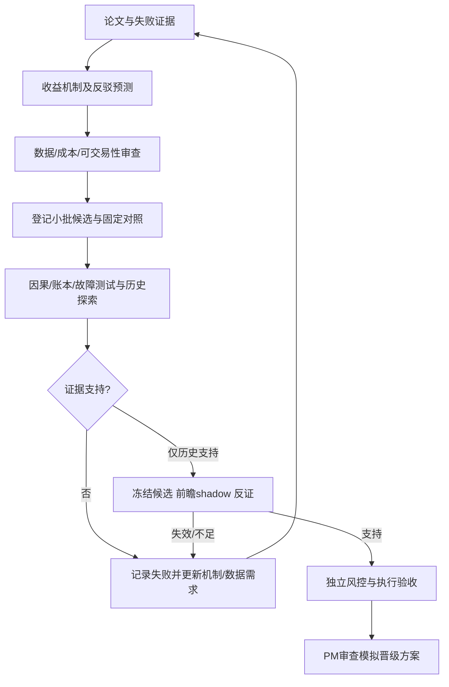

# BTC持续研究计划

PM已授权持续产生新机制并测试；这是第一轮通宵后的新工作范围。长期目标是找到成本后正期望候选。
先前20配置不改写。最新实际状态见TASKS和research/loop注册表，治理见ADR-0006。

## 已执行的新批次

BTC-LOOP-002：多周期现货趋势+风险缩放、上升大环境中的确认修复；8候选+4对照。
规则和成本在候选收益计算前登记；所有日期仍属已知历史探索。
修复新执行模型的等待意图被反复延后和零量bar成交风险，不修改旧研究。
结果见research/reports/BTC_LOOP_002.md；目前仍无研究/模拟达标者。

## 下一条队列（尚未冻结或测试）

1. **实际USDT永续多周期双向趋势**：现货只能long/flat，空头是否能提高下跌阶段净收益？
   用真实永续价格、mark、funding成本，区分方向信号与风险缩放；不加杠杆找alpha。
   对照必须有long-only、固定风险和只缩放版本，避免把收益简单归给做空权限。
2. **量价条件的延续与反转**：相同跌幅在异常成交量与正常成交量下，未来路径是否不同？
   正常量须按过去同UTC时段/星期估计，不能用全天未来总量界定“开盘”。
   先做条件收益/成交成本与样本量诊断，没机制证据就不包装策略。
3. **突破失败后的库存修复**：突破后重返原区间是否表现为临时冲击回补？
   明确确认、持有期限、无法止损场景，检验是否只是短波动/逆势尾部暴露。
4. **真实增量数据**：OI/成交主动方向/跨所价差的可得历史与发布时间。
   当前缺历史时先前瞻采集；不得拿今天看到的OI回填过去。Carry收益仍不研究。

以上是排序队列，不是尚未运行却已被称为有效的策略。每个新批次运行前才冻结具体候选和预算。

## 证据如何使循环前进

每批记录：被推翻了什么、剩下什么替代解释、下一条测试能区分哪两种机制、还需什么新数据。
历史筛查始终和前瞻/工程分离；跨批次调参不会获得新的未知历史。
单批最多8候选+4对照，一天最多2批；没有新机制时改进数据或补前瞻/工程，而不是机械扩大搜索。
找到候选后不再继续追求更漂亮历史曲线，转向保持规则不变的反证与未知数据观察。
